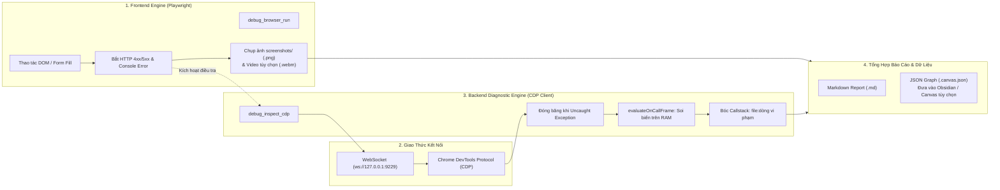
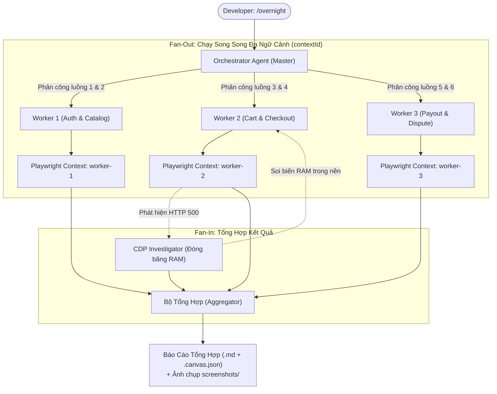

# Agentic TestOps — Autonomous Web Testing & Diagnostic Agent

### Hệ Thống Tự Động Hóa Kiểm Thử Web Application Toàn Trình Kết Hợp Browser Trace, Source Code Trace & Xuất Dữ Liệu Có Cấu Trúc

[](LICENSE)
[](https://modelcontextprotocol.io)
[](#1-hướng-dẫn-cài-đặt--tích-hợp-vào-một-dự-án-src-bất-kỳ)
[](https://playwright.dev)
[](https://chromedevtools.github.io/devtools-protocol/)

---

## Mục Lục
1. [Hướng Dẫn Cài Đặt & Tích Hợp Vào Một Dự Án (`src`) Bất Kỳ](#1-hướng-dẫn-cài-đặt--tích-hợp-vào-một-dự-án-src-bất-kỳ)
2. [Giới Thiệu, Triết Lý Cốt Lõi & Bảng Đối Chiếu Công Cụ](#2-giới-thiệu-triết-lý-cốt-lõi--bảng-đối-chiếu-công-cụ)
3. [Phương Pháp Luận & Kỹ Thuật Kiểm Thử Tích Hợp](#3-phương-pháp-luận--kỹ-thuật-kiểm-thử-tích-hợp)
4. [Kiến Trúc Hệ Thống 6 Tầng & Quy Trình RCA Toàn Trình](#4-kiến-trúc-hệ-thống-6-tầng--quy-trình-rca-toàn-trình)
5. [Các Chế Độ Vận Hành (Overnight Sweep & Tương Tác Ban Ngày)](#5-các-chế-độ-vận-hành-overnight-sweep--tương-tác-ban-ngày)
6. [Xuất Bằng Chứng: Ảnh, Video Tùy Chọn & Dữ Liệu Có Cấu Trúc](#6-xuất-bằng-chứng-ảnh-video-tùy-chọn--dữ-liệu-có-cấu-trúc)
7. [Cấu Trúc Thư Mục Plugin & Danh Mục 9 Công Cụ MCP](#7-cấu-trúc-thư-mục-plugin--danh-mục-9-công-cụ-mcp)
8. [Demo Thực Nghiệm TrustBase & Khung Đề Cương Đồ Án](#8-demo-thực-nghiệm-trustbase--khung-đề-cương-đồ-án)

> 📘 **Sổ tay chi tiết:** Xem thêm [HANDBOOK.md](./HANDBOOK.md) để lấy trọn bộ **5 mẫu Prompt thực chiến** (Black-Box, Grey-Box CDP, Coverage/Mutation, Overnight) và hướng dẫn xử lý sự cố từng bước.

---

## 1. Hướng Dẫn Cài Đặt & Tích Hợp Vào Một Dự Án (`src`) Bất Kỳ

Plugin được đóng gói theo chuẩn **100% Zero-Impact (Model Context Protocol - `stdio`)**: bạn **không cần cài đặt thêm bất kỳ thư viện nào vào mã nguồn (`src`) của dự án cần kiểm thử**. Chỉ cần thiết lập plugin này ở ngoài, gắn vào AI Host (Antigravity IDE, Gemini CLI, Claude Code) và trỏ vào URL / thư mục `src` bất kỳ.

### Bước 1: Cài đặt môi trường MCP & Playwright (Chỉ làm 1 lần trên máy)
> Yêu cầu **Node.js ≥ 22** (CDP client dùng `WebSocket` tích hợp sẵn của Node; trên Node 20 công cụ `debug_inspect_cdp` sẽ báo lỗi).

Mở terminal tại thư mục `agentic-test-ops/mcp`:
- **Windows (PowerShell)**:
  ```powershell
  cd agentic-test-ops\mcp
  npm install
  .\setup-browser.ps1
  ```
- **Linux / macOS**:
  ```bash
  cd agentic-test-ops/mcp
  npm install
  chmod +x setup-browser.sh && ./setup-browser.sh
  ```
*(Nếu máy đã có sẵn Google Chrome hoặc Microsoft Edge, `mcp/server.mjs` tự động fallback sang trình duyệt có sẵn ngay cả khi chưa tải Chromium).*

### Bước 2: Gắn Plugin / MCP Server vào dự án `src` bất kỳ
Chọn 1 trong các cách sau tùy công cụ AI bạn dùng khi mở thư mục `<duong-dan-src-bat-ky>`:

- **Cách A — Antigravity IDE / Gemini CLI (Khuyên dùng):**
  1. Copy thư mục `agentic-test-ops` vào thư mục plugin toàn máy `%USERPROFILE%\.gemini\config\plugins\agentic-test-ops\` *(Windows)* / `~/.gemini/config/plugins/agentic-test-ops/` *(Linux/macOS)*, **hoặc** chép vào `<duong-dan-src-bat-ky>\.agents\plugins\agentic-test-ops\` để dùng riêng cho dự án đó.
  2. Hoặc khai báo trực tiếp trong file cấu hình MCP (`mcp_config.json`):
     ```json
     {
       "mcpServers": {
         "debug-controller": {
           "command": "node",
           "args": ["C:/Users/<TenUser>/agentic-test-ops/mcp/server.mjs"]
         }
       }
     }
     ```
     *(Tùy chọn: có thể thêm `"env": { "CANVAS_RAG_DIR": "<duong-dan-obsidian-hoac-canvas-tuy-chon>" }` nếu muốn tự động đồng bộ file `.canvas.json` vào vault Obsidian hoặc công cụ canvas khác).*

- **Cách B — Claude Code:**
  ```bash
  claude plugin install C:/Users/<TenUser>/agentic-test-ops
  ```

- **Cách C — VS Code F5 Human-in-the-Loop (Tùy chọn):**
  Copy 2 file `vscode/launch.json` và `vscode/tasks.json` vào `<duong-dan-src-bat-ky>\.vscode\`. Khi Agent khoanh vùng được lỗi backend qua `--inspect=9229`, bạn đặt Breakpoint trong `src` và nhấn **F5** (*"F5: Attach to Node (Inspect Port 9229)"*) mà không cần restart server.

### Bước 3: Bật Backend của `src` mục tiêu & Ra lệnh Prompt cho AI Agent
1. Nếu dự án `src` dùng Database/Redis, bật hạ tầng trước.
2. Cho phép Backend Node.js mở debug port `--inspect=127.0.0.1:9229` để dùng được tính năng soi biến RAM qua CDP:
   - Tự bật trong `src` bằng lệnh `node`/`tsx` **cuối cùng**: `node --inspect=127.0.0.1:9229 dist/main.js` (hoặc `tsx --inspect=127.0.0.1:9229 src/main.ts`).
   - ⚠️ **Không** đặt `NODE_OPTIONS=--inspect` lên `npm run` / `pnpm dev`: `NODE_OPTIONS` được truyền cho mọi tiến trình Node con, nên chính `npm`/`pnpm` chiếm cổng 9229 trước, còn app thật báo `address already in use` và chạy **không có debugger**.
   - Luôn bind `127.0.0.1`, không dùng `0.0.0.0`: inspector mở ra mạng LAN đồng nghĩa với cho phép thực thi mã từ xa.
   - **Hoặc** giao cho AI Agent tự dọn cổng và bật server qua `debug_status` -> `debug_kill_ports` -> `debug_start_server`.
   - *(Nếu `src` viết bằng Python / Java / Go / PHP: các công cụ Black-Box Playwright, chụp ảnh, quay video tùy chọn, xuất báo cáo `.md`/`.canvas.json` và chạy test vẫn hoạt động bình thường; riêng `debug_inspect_cdp` soi Heap RAM chỉ áp dụng cho Node.js/V8).*
3. Gõ thẳng Prompt vào khung chat khi đang mở `<duong-dan-src-bat-ky>`:
   ```text
   Hãy đọc cấu trúc src dự án hiện tại để xác định cổng Frontend/Backend và các luồng nghiệp vụ chính.
   1. Gọi `debug_status` kiểm tra cổng; nếu cần hãy bật Backend với `--inspect=9229` bằng `debug_start_server`.
   2. Dùng `debug_browser_run` (headless: false, slowMo: 400) mở Chrome trực tiếp kiểm thử luồng [Tên luồng] theo Weak Robust EP, BVA (4n+1 / 6n+1 / 5^n), Decision Table và FSM.
   3. Nếu gặp lỗi HTTP >= 400 hoặc crash giao diện, gọi `debug_inspect_cdp` để bắt biến Heap RAM và Callstack file:line.
   4. Viết Regression Test cô lập trong `tests/` (đạt Statement/Branch Coverage) chạy bằng `debug_run_test`, sau đó gọi `debug_export_rag_report` để xuất `.md`, `.canvas.json` và ảnh chụp lỗi trong `screenshots/`.
   ```
   *(Xem đầy đủ 5 mẫu Prompt chi tiết trong [HANDBOOK.md](./HANDBOOK.md#4-bộ-prompt-thực-chiến-cho-mọi-dự-án-web--backend)).*

### Bước 4: Xem Ảnh, Video Tùy Chọn & Dữ Liệu Có Cấu Trúc
- **Ảnh chụp màn hình thực tế:** Kiểm tra tại `screenshots/*.png` (chụp đúng trạng thái DOM/HTTP thật lúc test hoặc khi lỗi).
- **Video quay trình duyệt (tùy chọn):** Khi chạy kịch bản hỗ trợ cờ `--record-video` (hoặc `RECORD_VIDEO=1`), Playwright `recordVideo` xuất file `.webm` vào `videos/`.
- **Dữ liệu có cấu trúc:** Đọc hồ sơ lỗi chi tiết trong `knowledge/*.md` và mở file `knowledge/*.canvas` (chuẩn JSON Canvas) trực tiếp bằng **Obsidian Canvas**; file `knowledge/*.canvas.json` là đồ thị có cấu trúc cho công cụ canvas tùy chọn (tự động đồng bộ cả hai nếu đặt biến `CANVAS_RAG_DIR`).

---

## 2. Giới Thiệu, Triết Lý Cốt Lõi & Bảng Đối Chiếu Công Cụ

**Agentic TestOps** là một nền tảng kiểm thử phần mềm tự hành ứng dụng **AI Agent** kết hợp giao thức **Model Context Protocol (MCP)**, hoạt động hoàn toàn độc lập với mã nguồn cần kiểm thử (**Zero-Impact Architecture**).

Khác với các kịch bản tự động hóa truyền thống vốn thụ động và dễ vỡ (*Flaky*), hệ thống hiện thực hóa quy trình **Site Reliability Engineering (SRE) khép kín**:

```mermaid
flowchart LR
    OBS["1. Quan sát (Observe)\nPlaywright DOM + Network 500"] --> REA["2. Suy luận (Reason)\nAI Agent & Semantic Memory"]
    REA --> ACT["3. Thực thi (Act)\nChrome Headless / Headed\nPhân luồng song song"]
    ACT --> INV["4. Điều tra (Investigate)\nCDP WebSocket Soi RAM\n& Callstack"]
    INV --> VER["5. Kiểm định (Verify)\nSinh Regression Test Cô lập\n& Xác minh Vá lỗi"]
    VER --> DOC["6. Xuất Kết Quả (Export)\nẢnh .png + Video tùy chọn\n+ Markdown .md & JSON .canvas.json"]
    DOC --> MEM["7. Ghi nhớ (Remember)\nAI đọc lại tri thức RAG\ncho các phiên sau"]
    MEM -.->|"Tối ưu hóa kịch bản biên"| OBS

    style OBS fill:#e8f4fd,stroke:#17a2b8
    style REA fill:#fff3cd,stroke:#ffc107
    style ACT fill:#d4edda,stroke:#28a745
    style INV fill:#fce8e6,stroke:#dc3545
    style VER fill:#e2d9f3,stroke:#6f42c1
    style DOC fill:#d1ecf1,stroke:#0c5460
    style MEM fill:#fef3c7,stroke:#f59e0b
```



| Khía Cạnh So Sánh | Kiểm Thử Thủ Công | Playwright / Cypress Thuần | GenAI Script Generator Thế Hệ 1 | **Agentic TestOps (Đề Xuất)** |
|---|---|---|---|---|
| **Kiến trúc Tích hợp** | Không áp dụng | Cần `npm install` đè vào dự án | Copy-paste tay từ cửa sổ chat | **Zero-Impact Plugin (gắn ngoài qua MCP)** |
| **Truy vết Nguyên nhân (RCA)** | Đọc log terminal thủ công | Mù Backend (chỉ thấy mã HTTP 500) | Dự đoán mò theo ngữ cảnh code | **Soi biến trực tiếp trên RAM Heap qua CDP** |
| **Khả năng Chống Flaky** | Phụ thuộc người test | Dễ vỡ khi DOM đổi hoặc kẹt port | Sinh code cứng, không tự phục hồi | **Tự diệt Zombie Port & Auto-Wait thông minh** |
| **Góc nhìn Kiểm thử** | Black-Box (UI) | Black-Box (UI / API) | Đoán ngữ nghĩa tĩnh | **Hộp đen (EP/BVA/FSM) + Hộp xám/trắng (CDP/Coverage/Mutation)** |
| **Đầu ra & Lưu trữ** | Word / Excel rời rạc | HTML Report đọc xong dễ trôi | Text chat không có cấu trúc | **Ảnh `.png`, Video tùy chọn `.webm`, Markdown `.md` & JSON `.canvas.json` (Obsidian/Canvas)** |

---

## 3. Phương Pháp Luận & Kỹ Thuật Kiểm Thử Tích Hợp

Hệ thống không sinh kịch bản ngẫu hứng mà áp dụng đồng bộ các kỹ thuật thiết kế kiểm thử phần mềm chính quy theo **V-Model** và chuẩn **ISO/IEC/IEEE 29119 / 829**:

| Nhóm phương pháp | Kỹ thuật áp dụng | Cách hệ thống thực thi thực tế |
|---|---|---|
| **Kiểm thử Hộp đen (Black-Box)** (`agents/flow-worker.md`) | **Equivalence Partitioning (Weak Robust EP)** | Tuân thủ *Single Fault Assumption*: mỗi ca kiểm thử chỉ cho duy nhất 1 biến nhận giá trị Invalid, các biến khác giữ Valid để triệt tiêu hiện tượng **che giấu lỗi (Fault Masking)**. |
| **Kiểm thử Hộp đen (Black-Box)** (`agents/flow-worker.md`) | **Boundary Value Analysis (BVA 3 cấp độ)** | • **Standard BVA ($4n+1$):** $\{\min, \min^+, \text{nom}, \max^-, \max\}$.<br>• **Robustness BVA ($6n+1$):** mở rộng $\min^-, \max^+$ kiểm tra Exception Handling (ví dụ: rút tiền `49.999đ` dưới ngưỡng `50.000đ`).<br>• **Worst-Case ($5^n$):** giả định đa lỗi đồng thời cho module tài chính/Escrow/hoa hồng `BigInt`. |
| **Kiểm thử Hộp đen (Black-Box)** (`agents/flow-worker.md`) | **Decision Table & State Transition (FSM)** | Lập bảng quyết định đa điều kiện (eKYC × Số dư × VietQR × Voucher) và kích hoạt cả **Valid** lẫn **Invalid Transitions** (ví dụ: Payout khi đơn hàng đang `CANCELLED`/`DISPUTED`). |
| **Kiểm thử Hộp xám / Hộp trắng (Grey/White-Box)** (`mcp/cdp-client.mjs`) | **Dual-Trace CDP Heap Inspection** | Tương tác từ UI Black-Box (`Playwright`) ➔ tự động gắn WebSocket CDP `ws://127.0.0.1:9229` đóng băng tiến trình khi có Uncaught Exception, soi biến sống trên RAM Heap & Callstack `file:line`. |
| **Chất lượng bộ Test Hồi quy** (`skills/overnight-sweep/SKILL.md`) | **Statement/Branch Coverage, McCabe & Mutation Testing** | Bộ test hồi quy Tầng 6 nhắm tới **Phủ cấp 1 (Statement)**, **Phủ cấp 2 (Branch True/False)**, đo độ phức tạp chu trình **McCabe** $V(G)=P+1$ và kiểm định độ nhạy bằng **Mutation Testing**. |
| **Quy trình & Chống Flaky** (`agents/orchestrator.md`) | **V-Model, ISO/IEEE Error Chain & Defect Lifecycle** | Đối ứng **Validation** (UI E2E) ↔ **Verification** (CDP/Unit); phân rạch chuỗi `Error -> Fault -> Failure -> Incident`; gắn vòng đời `New -> Open -> Investigating (CDP) -> Fixed -> Re-test -> Closed`. |

---

## 4. Kiến Trúc Hệ Thống 6 Tầng & Quy Trình RCA Toàn Trình

```text
┌────────────────────────────────────────────────────────────────────────────┐
│ Tầng 6: Tự Động Sinh Regression Test (Vitest / Playwright Suite)           │
├────────────────────────────────────────────────────────────────────────────┤
│ Tầng 5: Xuất Dữ Liệu Có Cấu Trúc (.md RAG & .canvas.json cho Obsidian/UI) │
├────────────────────────────────────────────────────────────────────────────┤
│ Tầng 4: RAG Knowledge Memory (Bộ nhớ ngữ nghĩa cho AI học lại qua phiên)   │
├────────────────────────────────────────────────────────────────────────────┤
│ Tầng 3: Root Cause Analysis (RCA 4-Step Loop: Ngược dòng Callstack & Heap) │
├────────────────────────────────────────────────────────────────────────────┤
│ Tầng 2: Source Code Trace & Debug Session (Node Inspect --inspect=9229)    │
├────────────────────────────────────────────────────────────────────────────┤
│ Tầng 1: Browser Automation, Trace & Media (Playwright, PNG, Video tùy chọn)│
└────────────────────────────────────────────────────────────────────────────┘
```

### 4.1. Cơ Chế Phối Hợp Giữa Frontend Playwright & Backend CDP Debugger



### 4.2. Quy Trình Phân Tích Sự Cố (Full-Stack RCA Loop 4 Bước)

1. **Triệu chứng (Symptom):** Playwright chạy `debug_browser_run` (hỗ trợ `headless: false` để xem trực tiếp và `slowMo`), bắt `page.on('response')` (>= 400), `page.on('console')`, `page.on('pageerror')` và tự chụp ảnh bằng chứng lưu vào `screenshots/`.
2. **Truy vết & Chụp RAM (Trace):** Khi API văng lỗi 500, `debug_inspect_cdp` truy vấn `http://127.0.0.1:9229/json/list`, kết nối WebSocket mở `Debugger.setPauseOnExceptions({ state: 'all' })` (mặc định `all` vì Express/NestJS bắt lỗi rồi trả 500, nên chế độ `uncaught` không dừng; exception phát sinh trong `node_modules` được tự bỏ qua) và gọi `Debugger.evaluateOnCallFrame` đọc giá trị biến sống trên Heap RAM cùng `file:line:col` của backend rồi tự `Debugger.resume`.
3. **Chứng minh (Proof):** Kỹ sư có thể nhấn **F5** trên VS Code (`vscode/launch.json`) để gắn trực tiếp vào cùng phiên backend, hoặc Agent chạy test cô lập qua `debug_run_test`.
4. **Hồi quy & Xuất dữ liệu (Defense & Export):** Agent viết Regression Test chuẩn Phủ câu lệnh/Phủ nhánh vào `tests/` và gọi `debug_export_rag_report` / `debug_export_overnight_report` để lưu hồ sơ sự cố.

---

## 5. Các Chế Độ Vận Hành (Overnight Sweep & Tương Tác Ban Ngày)

### 5.1. Autonomous Overnight SRE Sweep (Quét Đa Luồng Song Song)



- **Chạy song song đa ngữ cảnh (`contextId`):** Worker 1, 2, 3 chạy độc lập cookie/storage, giảm thời gian chạy 6 flows từ ~45-60 phút xuống **12–15 phút**.
- **Non-blocking Triage:** Một worker gặp HTTP 500 thì `cdp-investigator` bắt RAM trong nền, các worker còn lại vẫn tiếp tục chạy.

### 5.2. Các Chế Độ Tương Tác Ban Ngày
- **Chế độ 1 — Dọn cổng & Khởi động Server Debug:** `debug_status` -> `debug_kill_ports` -> `debug_start_server` (`--inspect=127.0.0.1:9229`).
- **Chế độ 2 — Kiểm thử UI trực tiếp trên Chrome:** `debug_browser_run` với `headless: false`, `slowMo: 400` để theo dõi trực quan từng thao tác click, điền form và log network.
- **Chế độ 3 — Soi RAM Bug 500 đơn lẻ:** `debug_inspect_cdp` bắt Callstack + giá trị biến Heap khi văng lỗi mà không cần `console.log`.
- **Chế độ 4 — Human-in-the-loop VS Code F5:** Đặt Breakpoint trong `src` và nhấn **F5** (*"Attach to Node Inspect"*).

---

## 6. Xuất Bằng Chứng: Ảnh, Video Tùy Chọn & Dữ Liệu Có Cấu Trúc

Hệ thống không ép buộc sử dụng một phần mềm xem đồ thị cố định nào; mọi bằng chứng đều được xuất ra **các định dạng mở, chuẩn hóa và dễ kiểm chứng**:

| Nhóm đầu ra | Đường dẫn / Cơ chế tạo | Nội dung & Cách sử dụng |
|---|---|---|
| **1. Ảnh chụp màn hình thực tế (`.png`)** | `screenshots/*.png`<br>*(tự tạo khi `debug_browser_run` lỗi/lệnh `screenshot` hoặc từ kịch bản E2E)* | Ghi lại đúng trạng thái DOM/UI thực tế tại từng bước hoặc thời điểm lỗi (ví dụ đơn hàng VietQR, thông báo khóa eKYC) để đối chiếu với HTTP log. |
| **2. Video quay trình duyệt tùy chọn (`.webm`)** | `videos/*.webm`<br>*(bật qua cờ `--record-video` hoặc `RECORD_VIDEO=1` trong `record_multi_role_detailed_demo.mjs` sử dụng Playwright `recordVideo`)* | Khi cần quay lại toàn bộ thao tác trực quan trên cửa sổ Chrome thật để xem lại hoặc làm video báo cáo. *(Mặc định tắt nếu chỉ cần ảnh & log nhẹ).* |
| **3. Báo cáo Markdown có cấu trúc (`.md`)** | `knowledge/<ID>-<slug>.md`<br>*(tạo bởi `debug_export_rag_report` / `debug_export_overnight_report`)* | Tổng hợp Test Matrix (EP/BVA/Decision Table/FSM), Console Error, Failed HTTP Request, `sourceLocation` (`file:line`), biến RAM từ CDP, nguyên nhân gốc RCA và đường dẫn file test hồi quy. AI dùng lại làm Semantic Memory. |
| **4. Dữ liệu đồ thị JSON có cấu trúc (`.canvas.json` + `.canvas`)** | `knowledge/<ID>-<slug>.canvas.json`<br>`knowledge/<ID>-<slug>.canvas`<br>*(tùy chọn tự sync nếu cấu hình biến `CANVAS_RAG_DIR` hoặc tham số `canvasRagDir`)* | Chứa cấu trúc Nodes/Edges/Sub-Clusters (Test Matrix -> Browser Trace -> CDP Root Cause & Regression) ở dạng JSON sạch cho công cụ canvas/dashboard tùy chọn; kèm file `.canvas` chuẩn JSON Canvas 1.0 mở **trực tiếp bằng Obsidian Canvas**. Exporter chỉ ghi dữ liệu được truyền vào, không tự sinh kết quả mẫu. |

---

## 7. Cấu Trúc Thư Mục Plugin & Danh Mục 9 Công Cụ MCP

```text
agentic-test-ops/
├── .claude-plugin/
│   └── plugin.json                        # Khai báo định danh Plugin cho Claude Code / Host
├── .github/
│   └── workflows/
│       └── agentic-testops-ci.yml         # CI: self-test 9 công cụ MCP (CDP, browser, exporter) trên Node 22/24
├── mcp/
│   ├── server.mjs                         # Máy chủ MCP JSON-RPC 2.0 stdio (9 công cụ)
│   ├── cdp-client.mjs                     # Engine kết nối WebSocket tới Node Inspect CDP
│   ├── rag-exporter.mjs                   # Module xuất Markdown (.md) & dữ liệu JSON (.canvas.json)
│   ├── package.json                       # Dependency duy nhất: playwright (JSON-RPC tự viết, không dùng MCP SDK; Node ≥ 22)
│   ├── setup-browser.ps1                  # Cài đặt Chromium (Windows PowerShell)
│   └── setup-browser.sh                   # Cài đặt Chromium (Linux / macOS)
├── agents/
│   ├── orchestrator.md                    # Điều phối quét song song & V-Model
│   ├── flow-worker.md                     # Thi hành kiểm thử Hộp đen (EP, BVA, Decision Table, FSM)
│   ├── cdp-investigator.md                # Điều tra sâu Heap RAM qua CDP
│   └── debugger.md                        # Gỡ lỗi RCA 4 bước & chống Flaky
├── commands/
│   ├── debug.md                           # Lệnh tương tác /debug
│   └── overnight.md                       # Lệnh quét xuyên đêm /overnight
├── skills/
│   ├── debug-rca/SKILL.md                 # Kỹ năng chẩn đoán lỗi 4 bước
│   └── overnight-sweep/SKILL.md           # Giao thức điều phối quét nhiều luồng qua đêm
├── .mcp.json                              # Khai báo MCP server cho Claude Code (nạp debug-controller)
├── scripts/
│   └── mcp-call.mjs                       # Client MCP stdio: gọi 1 tool thật từ dòng lệnh (--list để liệt kê)
├── tests/
│   ├── self/tools.test.mjs                # Self-test công cụ qua giao thức MCP (chạy trong CI)
│   └── trustbase/trustbase.test.mjs       # 30 ca kiểm thử TrustBase (6 luồng), chạy bằng debug_run_test
├── testcases/
│   ├── trustbase_testcases.json           # Thiết kế 30 ca: kỹ thuật, kết quả mong đợi, nguồn đặc tả (chốt trước khi chạy)
│   ├── trustbase-fixtures.sql             # Fixture cho DB local
│   ├── reset-local-env.sh                 # Áp fixture + xóa bộ đếm rate limit (chỉ container local)
│   ├── cdp-*.json                         # Bằng chứng debug_inspect_cdp (exception, breakpoint)
│   └── results/                           # Kết quả từng lần chạy; run7-final.json là kết quả chính thức
├── knowledge/                             # Báo cáo .md/.canvas.json/.canvas xuất ra từ lần chạy thật
├── screenshots/                           # Thư mục lưu ảnh chụp thực tế không giả lập
├── vscode/
│   ├── launch.json                        # Cấu hình nhấn F5 Attach Node Inspect
│   └── tasks.json                         # Task dọn cổng zombie
├── CHAY_DEMO_AGENTIC_TESTOPS.bat          # Chạy nhanh demo Web TrustBase trực quan (4 màn hình)
├── XUAT_BANG_CHUNG_TESTOPS.bat            # Chạy E2E 3 phân vai kiểm chứng nghiêm ngặt DOM/HTTP
├── demo_trustbase_real.mjs                # Script demo UI thực tế trên TrustBase
├── record_multi_role_detailed_demo.mjs    # Script E2E Buyer -> Seller -> Admin (hỗ trợ --record-video)
├── HANDBOOK.md                            # Sổ tay cài đặt vào src bất kỳ, kỹ thuật kiểm thử & Prompt mẫu
├── Nhom5_AgenticTestOps.pdf               # Báo cáo đồ án môn học (Nhóm 05, 18 trang)
├── Nhom05_AgenticTestOps_ThuyetTrinh.pdf  # Slide thuyết trình bảo vệ (10 slides 16:9, Notion-Clean)
├── Nhom05_TestCase_TrustBase.xlsx         # Bảng đặc tả 30 ca kiểm thử, Defect Log & Dashboard
└── README.md
```

### Danh Mục 9 Công Cụ Trong `mcp/server.mjs`

| Tên Công Cụ | Tham Số Chính | Chức Năng Thực Thi |
|---|---|---|
| **`debug_status`** | `ports[]` | Quét các cổng mạng (`4200`, `4201`, `4203`, `9229`...) để phát hiện xung đột hoặc tiến trình zombie. |
| **`debug_kill_ports`** | `ports[]` | Force-kill tiến trình đang chiếm cổng, dập tắt lỗi `EADDRINUSE`. |
| **`debug_start_server`** | `command`, `inspectPort`, `cwd`, `app` | Dọn cổng kẹt và khởi chạy backend với `NODE_OPTIONS="--inspect=127.0.0.1:<port>"`; trả cảnh báo nếu lệnh chạy qua npm/pnpm hoặc app không mở được inspector. |
| **`debug_stop_server`** | `app` | Ngắt tiến trình backend đã mở để dọn dẹp môi trường. |
| **`debug_browser_run`** | `url`, `actions[]`, `contextId`, `headless`, `slowMo`, `timeoutMs` | Chạy Playwright Chromium (ẩn hoặc mở cửa sổ `headless: false`), bắt Console Error, Page Error, HTTP >= 400 và tự lưu ảnh lỗi vào `screenshots/`. |
| **`debug_inspect_cdp`** | `inspectPort`, `pauseOnExceptions` (mặc định `all`), `expressions[]`, `breakpoints[]`, `targetFilter`, `timeoutMs` | Kết nối WebSocket CDP (`ws://127.0.0.1:<port>`), đóng băng tiến trình khi văng exception để đọc biến sống trên Heap RAM và Callstack. |
| **`debug_run_test`** | `command`, `cwd`, `timeoutMs` | Chạy file kiểm thử đơn vị / hồi quy cô lập và lấy kết quả Pass/Fail kèm log chi tiết. |
| **`debug_export_rag_report`** | `testId`/`bugId`, `title`, `route`, `testCases[]`, `testingTechniques[]`, `coverageMetrics`, `cdpHeapInspection`, `symptoms`, `sourceLocation`, `rootCause`, `canvasRagDir`, `syncToCanvasDir` | Xuất báo cáo sự cố đơn luồng dạng `.md` + `.canvas.json` + `.canvas` (Obsidian); bắt buộc có `testCases[]` (tùy chọn sync sang `CANVAS_RAG_DIR` / `canvasRagDir` cho Obsidian Canvas hoặc công cụ tùy chọn). |
| **`debug_export_overnight_report`** | `sweepId`, `date`, `flows[]`, `canvasRagDir` | Tổng hợp kết quả nhiều luồng, kèm Heap RAM từ CDP, xuất `OVERNIGHT-SWEEP-<date>.md` và `.canvas.json`. |

---

## 8. Demo Thực Nghiệm TrustBase & Khung Đề Cương Đồ Án

### 8.0. Kết Quả Thực Nghiệm Thật (24/11/2026)

- **SUT:** TrustBase chạy local (API `--inspect=127.0.0.1:9229`, PostgreSQL 18 + Redis 7 bằng Docker), dữ liệu là bản sao dump production 18/11/2026 đã áp đủ migration; email ở chế độ console, thanh toán mock.
- **Thiết kế:** 30 ca / 6 luồng (Auth, Catalog, Order & Inventory, Voucher, Payout & Fee, Dispute), mỗi luồng 1 happy path + 4 edge case (BVA, EP, FSM, đồng thời, IDOR, SQLi/XSS). Kết quả mong đợi lấy từ đặc tả và cấu hình TrustBase, chốt trước khi chạy: [`testcases/trustbase_testcases.json`](testcases/trustbase_testcases.json).
- **Thực thi:** qua công cụ MCP `debug_run_test` (phần giao diện XSS qua `debug_browser_run`); lần chạy chính thức `run7-final`: **25/30 đạt (83,3%)**, 0 lỗi 5xx. Các lần chạy trước (gỡ lỗi môi trường, fixture, thiết kế) được lưu trong `testcases/results/`.
- **Lỗi phát hiện** (hồ sơ trong `knowledge/`, xuất bằng `debug_export_rag_report` / `debug_export_overnight_report`):

| Mã | Lỗi | Mức độ |
|---|---|---|
| F-01 | Tham số `sort` bị bỏ qua khi tìm kiếm có từ khóa | Medium |
| F-02 | Mở được khiếu nại trên đơn chưa thanh toán (CDP breakpoint: `awaiting_payment` → `CHO_CK`) | High |
| F-03 | Người ngoài dò được trạng thái khiếu nại của đơn người khác (kiểm quyền sau kiểm trạng thái) | Medium |
| F-04 | Mã lỗi voucher chung `VOUCHER_INVALID` thay vì mã cụ thể | Low |
| F-05 | Tạo đơn dùng chung bộ đếm rate limit với thao tác tài chính → bị chặn mở khiếu nại | Medium |

Chạy lại trên máy có TrustBase local:
```powershell
bash testcases/reset-local-env.sh
node scripts/mcp-call.mjs debug_run_test '{"command":"node --test --test-concurrency=1 tests/trustbase/trustbase.test.mjs","timeoutMs":1500000}'
```

### 8.1. Chạy Demo Trực Quan Trên Nền Tảng TrustBase
> Yêu cầu: Hệ thống TrustBase đang chạy (`localhost:4200` Customer/Seller Web, `localhost:4201` API, `localhost:4203` Admin Console).

1. **Demo Web khách hàng & Bảng phí Escrow (`headless: false`):** Double-click `CHAY_DEMO_AGENTIC_TESTOPS.bat` (chạy `demo_trustbase_real.mjs`, lưu ảnh tại `screenshots/real_01..04*.png`).
2. **Demo E2E 3 phân vai kiểm chứng DOM/HTTP nghiêm ngặt:** Double-click `XUAT_BANG_CHUNG_TESTOPS.bat` (chạy `record_multi_role_detailed_demo.mjs` — mọi bước đều xác minh HTTP status & DOM thật, không bao giờ báo thành công ảo khi bị khóa eKYC hoặc sai route; thêm cờ `--record-video` nếu muốn lưu thêm `.webm` vào `videos/`).

### 8.2. Khung Câu Hỏi & Đề Cương Đồ Án Tốt Nghiệp (Nhóm 05)
- **RQ1–RQ5 & Giả thuyết (H1–H4):** Đo hiệu quả giảm 40–60% thời gian thiết kế/chạy test lặp lại, tăng độ chính xác RCA (>85%) nhờ Dual-Trace (Playwright + CDP Heap), giảm 70% thời gian thẩm định lỗi nhờ báo cáo có cấu trúc (`.md` + `.canvas.json` + ảnh thực tế), và kiểm chứng độ nhạy Regression Test bằng Mutation Testing.
- **Đề cương 7 chương báo cáo:** Chương 1 (Tổng quan) ➔ Chương 2 (Cơ sở lý thuyết Playwright, CDP, MCP, EP/BVA/FSM, Mutation Testing) ➔ Chương 3 (Kiến trúc 6 tầng & Schema dữ liệu) ➔ Chương 4 (Hiện thực hóa MCP Server, CDP & Exporter) ➔ Chương 5 (Thực nghiệm trên TrustBase 6 flows / 30 test cases) ➔ Chương 6 (Phân tích kết quả & Defect Log) ➔ Chương 7 (Kết luận & Hướng phát triển Self-Healing PR).

---

## Giấy Phép & Bản Quyền
Dự án được phát hành theo giấy phép **MIT License**. Tự do sử dụng, sửa đổi và tích hợp vào các dự án kiểm thử thực tế, công trình nghiên cứu khoa học hoặc đồ án tốt nghiệp.
